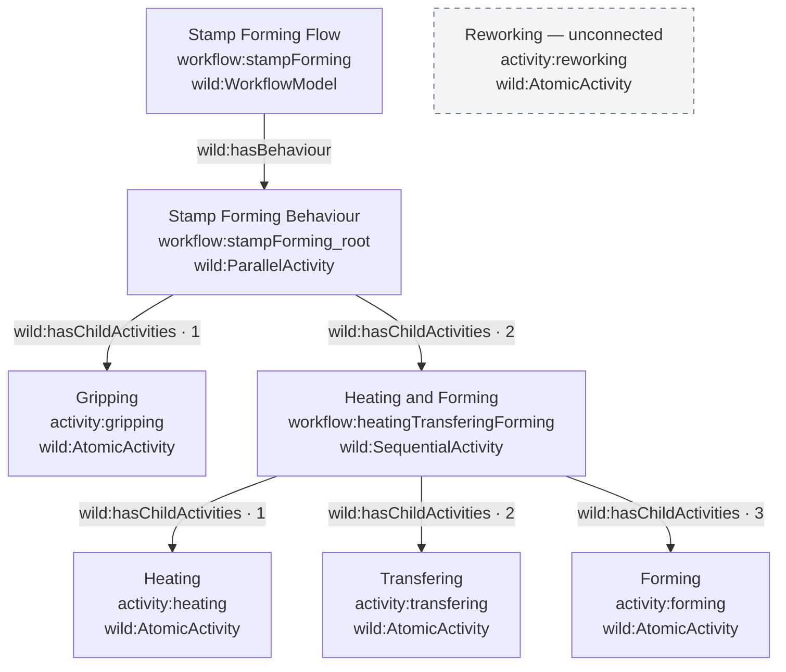
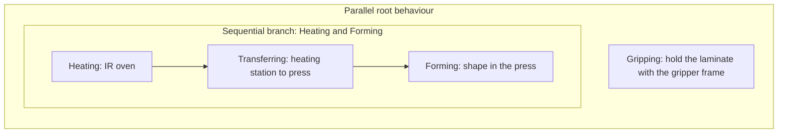

# Stamp forming workflow model

Source: [`../workflow.ttl`](../workflow.ttl).

The model describes stamp forming a composite laminate. Its root behaviour contains two parallel branches: gripping the laminate and a sequence of heating, transferring, and forming. Reworking is declared separately but is not connected to the workflow.

## Model structure

The arrows below show containment and the behaviour reference, not execution transitions. Numbers indicate positions in the RDF child lists; the parallel branch positions do not imply execution order.



## Process interpretation



Gripping runs as a parallel branch alongside the heating–transferring–forming sequence. Its comment describes holding the laminate during heating and forming. Within the sequential branch, heating precedes transferring, which precedes forming. The file does not specify exact start times, durations, synchronization conditions, or execution records; this diagram expresses the intended composition rather than a timed schedule.

## How the model is constructed

The file uses Turtle to encode an RDF graph. Prefix declarations abbreviate resource IRIs: `workflow:` identifies workflow resources, `activity:` identifies individual activities, and `wild:` supplies the workflow vocabulary. Only `workflow:`, `activity:`, `wild:`, and `rdfs:` are used in the statements; the other declared prefixes are unused in this file. Turtle's `a` is shorthand for `rdf:type`.

| Element | Construction and role |
| --- | --- |
| Workflow entry point | `workflow:stampForming` is a `wild:WorkflowModel`, with a label, comment, and a `wild:hasBehaviour` reference to the root activity. |
| Parallel composition | `workflow:stampForming_root` is a `wild:ParallelActivity`. Its child list contains `activity:gripping` and `workflow:heatingTransferingForming`. |
| Sequential composition | `workflow:heatingTransferingForming` is a `wild:SequentialActivity`. Its child list orders `activity:heating`, `activity:transfering`, and `activity:forming`. |
| Leaf activities | Gripping, heating, transferring, and forming are `wild:AtomicActivity` resources. Each has an `rdfs:label` and an `rdfs:comment`, with no child activities defined here. |
| Separate activity | `activity:reworking` is also a `wild:AtomicActivity`, but no child list or behaviour reference includes it. It is not a reachable step of the stamp forming workflow. |

The two composition resources use Turtle collections:

```turtle
workflow:stampForming_root a wild:ParallelActivity ;
    wild:hasChildActivities (
        activity:gripping
        workflow:heatingTransferingForming
    ) .

workflow:heatingTransferingForming a wild:SequentialActivity ;
    wild:hasChildActivities (
        activity:heating
        activity:transfering
        activity:forming
    ) .
```

Each parenthesized collection expands into an RDF list using `rdf:first`, `rdf:rest`, and `rdf:nil`. Thus, `wild:hasChildActivities` points to a list, rather than directly to each child. The structure diagram abbreviates these list nodes for readability. Both lists preserve their written order, but the parent's activity type determines whether the children represent parallel branches or a sequence. The file contains no explicit transition edges between the atomic activities.

Labels provide display text, while comments describe the workflow and atomic activities. References to the gripper frame, IR oven, and press occur only in comments: this file does not link activities to machine resources, parameters, inputs, or outputs. It uses WILD classes and properties without defining their ontology or validation constraints locally.

The source spells the transferring activity `activity:transfering` with the label `"Transfering"`, and the sequence resource `workflow:heatingTransferingForming`. These identifiers and the diagram label are preserved exactly; the prose uses the standard spelling “transferring.” Reworking has no conditional branch or placement defined, so including it in the process would require an additional modelling decision.
