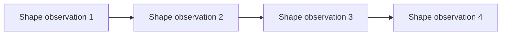

# Stamp forming workflow

Source: [`../workflow.ttl`](../workflow.ttl).

Read the manufacturing branch from left to right. The arrows name the movements between stations. Gripping and its 24 observations form a second parallel branch. Blue boxes show physical actions; amber boxes show observations.

```mermaid
flowchart TB

    subgraph workflow["Stamp forming · two parallel branches"]
        subgraph manufacturing["Manufacture and inspect · follow the arrows"]
            direction LR
            load["Load sheet"]:::process
            subgraph heat["Heat and observe · in parallel"]
                direction TB
                heating["Heat laminate"]:::process
                temperature["Measure surface temperature"]:::observation
                heating ~~~ temperature
            end
            press["Press into shape"]:::process
            inspect["Inspect shape<br/>4 observations, in order"]:::observation
            unload["Unload part"]:::process

            load -->|"Move to oven"| heat
            heat -->|"Move to press"| press
            press -->|"Move to inspection"| inspect
            inspect -->|"Move to unload"| unload
        end

        subgraph grip["Grip and monitor · activities run in parallel"]
            direction LR
            hold["Hold laminate<br/>with the gripper frame"]:::process
            angles["Measure gripper angles<br/>8 observations"]:::observation
            forces["Measure gripper forces<br/>8 observations"]:::observation
            extensions["Measure gripper extensions<br/>8 observations"]:::observation
            hold ~~~ angles ~~~ forces ~~~ extensions
        end

        manufacturing ~~~ grip
    end

    classDef process fill:#dbeafe,stroke:#2563eb,color:#172554
    classDef observation fill:#fef3c7,stroke:#b45309,color:#78350f
    style workflow fill:#ffffff,stroke:#94a3b8
    style manufacturing fill:#f8fafc,stroke:#64748b
    style heat fill:#f0fdf4,stroke:#16a34a
    style grip fill:#f8fafc,stroke:#64748b
```

The green container groups heating and surface temperature measurement as parallel activities. Inspection contains four shape observations in sequence:

Parallel composition does not specify exact start times or durations. The diagram preserves the declared sequence and parallel groups without adding scheduling rules.

## Correspondence with the RDF model

All activity identifiers below use the `activity:` prefix (`http://purl.org/for/activity#`).

| Diagram element | Activity identifiers |
| --- | --- |
| Two parallel branches | `stampFormingFlow` contains `manufactureAndObserve` and `gripAndObserve`. |
| Load sheet | `load` |
| Movements on the arrows | `moveToOven`, `moveToPress`, `moveToInspection`, `moveToUnload`, in that order |
| Heat and observe | `heatAndObserve` contains `heating` and `observeLaminateSurfaceTemperature1` in parallel. |
| Press into shape | `pressing` |
| Inspect shape | `inspection` contains `observeLaminateShape1` through `observeLaminateShape4` in sequence. |
| Unload part | `unload` |
| Hold laminate | `gripping` |
| Measure gripper angles | `observeGripperAngle1` through `observeGripperAngle8`, in parallel |
| Measure gripper forces | `observeGripperForce1` through `observeGripperForce8`, in parallel |
| Measure gripper extensions | `observeGripperExtension1` through `observeGripperExtension8`, in parallel |

The three measurement boxes summarize 24 atomic activities; they do not introduce new composite activities. The overview accounts for all 38 atomic activities in the source.

The workflow entry point is `workflow:stampForming`; its `wild:hasBehaviour` reference points to `activity:stampFormingFlow`. Ordered RDF lists in `wild:hasChildActivities` supply the sequence within `wild:SequentialActivity` resources. The direct `wild:hasChildActivity` links have no ordering of their own.

Use the [overview Mermaid source](workflow-overview.mmd) for presentations and the [complete workflow tree](workflow-tree.mmd) to inspect every activity and its parent.
